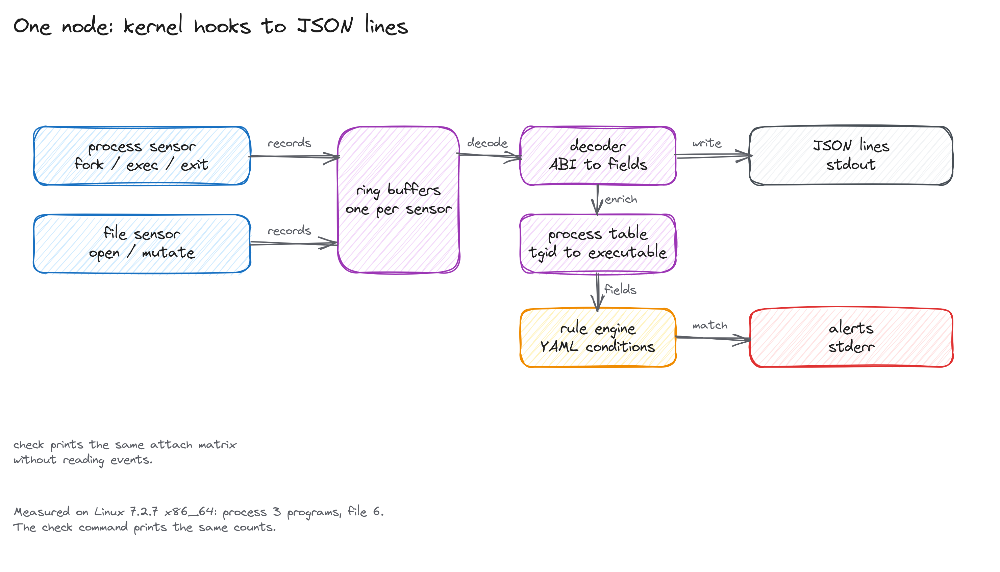

# eBPF runtime

Trace process execution and file activity on a Linux host. The tool loads
two eBPF sensors, reads their ring buffers, and writes one JSON object per
event. A small YAML rule engine marks sensitive file access while the
events stream.

It runs as one process and needs root or the BPF capabilities. There is no
server, database, or remote agent to deploy.

## Quick start

You need Linux 5.15 or newer with BTF at `/sys/kernel/btf/vmlinux`, Rust
1.95, clang 19, bpftool, and permission to load BPF programs.

```bash
git clone https://github.com/meillaya/eBPF-runtime
cd eBPF-runtime
cargo build --release -p runtime

sudo ./target/release/ebpf-runtime check
sudo ./target/release/ebpf-runtime run --pretty
```

`check` loads the sensors and prints what attached. The reason for a
blocked sensor goes to stderr. On a 7.2.7 kernel the table looks like this:

```text
sensor    status     attached  failed  skipped
process   capable           3       0        0
file      capable           6       0        0
```

`run` prints events from the process and file sensors. Run `cat` in another
terminal and the stream shows the exec, the file opens, and any rule that
matched:

```text
04:03:52.711 process exec pid=64032 tgid=64032 path=/bin/true
04:03:52.712 file open pid=64032 path=/usr/bin/true process=/usr/bin/bash
04:04:59.447 file open pid=65899 path=/etc/shadow process=/usr/sbin/cat
alert high sensitive-file-write-intent: Detects write-intent operations... (pid 65899 path /etc/shadow)
```

JSON is the default. Alerts go to stderr, so a pipeline keeps a clean event
stream:

```bash
sudo ./target/release/ebpf-runtime run \
  | tee events.jsonl \
  | jq -c 'select(.kind == "ProcessExec")'
```

The default rule directory is `rules/default`. Pass `--no-rules` to skip
it, or `--rules PATH` to load another directory.

## Requirements in detail

The build compiles the C sensors with clang 19. clang 20 and newer lower
large `__builtin_memcpy` calls to an unresolved `memcpy` extern. libbpf
cannot resolve that extern against the kernel BTF on the kernels tested
here, so the object fails to open. The build reports the wrong compiler
instead of producing an object that cannot load.

At run time the loader needs `CAP_BPF` and `CAP_PERFMON`. Loading an LSM
program also needs `CAP_SYS_ADMIN`. The simplest way to get all three is
root on the host or a privileged container:

```bash
podman build -t ebpf-runtime .
sudo podman run --rm --privileged --pid=host --cgroupns=host \
  ebpf-runtime run --pretty --rules /etc/ebpf-runtime/rules/default
```

`--pid=host` makes the sensor see host pids instead of container pids.
`--cgroupns=host` keeps cgroup ids meaningful. The image default command loads
`/etc/ebpf-runtime/rules/default`.

## What it records

The process sensor attaches to three raw tracepoints and reports fork,
successful exec, and exit. The file sensor attaches to the LSM
`file_open` hook and to five syscall kprobes for open, create, unlink,
rename, and truncate. Each record has a 96-byte header with the pid,
cgroup id, timestamp, and event kind.



The decoder is the only place that reads payload bytes. It turns a record
into named fields: `path`, `process_exec`, `exit_code`, `open_flags`, and
so on. The process table maps a thread group to its last executable, so a
file event can name the program that opened the file. Identical
`FileOpen` events from the same thread group and path within 50 ms are
collapsed, because the LSM hook and the openat2 kprobe report the same
open. The rule engine evaluates the YAML conditions on the named fields.

`check` uses the same loader and attach path as `run`. It reports a sensor
as `capable` when every attachable program attached, `degraded` when some
attached and some failed, and `blocked` when none attached.

## Commands

| Command | What it does |
|---|---|
| `ebpf-runtime check` | Load the sensors and print the attach status. `--json` prints the matrix. |
| `ebpf-runtime run` | Stream events. Flags: `--sensors`, `--rules`, `--no-rules`, `--pretty`, `--duration`, `--pid`, `--quiet`. |
| `ebpf-runtime rules check DIR` | Parse a rule directory and print the rule count. |

## One exec event

An `execve` call reaches the `sched_process_exec` raw tracepoint. The
sensor reads `bprm->filename`, copies up to 256 bytes into the record, and
submits 364 bytes to the ring buffer. The decoder writes the path and pid
as one JSON line.


The raw tracepoint does not carry argv, so `argv` is absent from exec
events. A file event for the same process is linked by thread group id, not
by pid alone.

## Rules

Rules are YAML. A rule names a source, a condition, a severity, and an
action. A compact version of the shipped write-intent rule:

```yaml
schema_version: 1
engine_version: "1.0.0"
rules:
  - id: sensitive-file-write-intent
    version: 1
    severity: high
    source: file
    description: Detect write-intent operations on sensitive files.
    condition:
      and:
        - field: file.kind
          operator: in
          value: ["FileOpen", "FileCreate", "FileTruncate"]
        - field: file.path
          operator: eq
          value: "/etc/shadow"
    action: alert
    exceptions:
      - field: process.exec_path
        operator: in
        value: ["/usr/bin/apt", "/usr/bin/dpkg", "/usr/bin/pacman"]
```

The runtime fills the fields the two sensors carry: `process.pid`,
`process.tgid`, `process.exec_path`, `process.argv` when captured,
`file.path`, and `file.kind`. A condition on a field the event does not
carry is false, so missing data cannot create a match.

Only plain conditions run. A rule with a `sequences` block is counted and
skipped, because the runtime does not keep correlation state across events
yet. `rules check` prints the count:

```bash
$ ./target/release/ebpf-runtime rules check rules/default
2 rules, 0 sequence rules skipped
```

The rule schema is enforced when a file loads. An unknown field, an
unbounded regex, or a deny action fails the load with a path to the bad
rule.

## Limits

The project records events. It does not block syscalls. The LSM program
attaches in audit mode and returns zero. A rule with `action: deny` is
rejected at load time rather than reported as if it blocked something.

The process sensor reports the binary path, not argv. The file sensor uses
`bpf_d_path` for the absolute path and falls back to the dentry name when
the helper fails, which can leave a basename instead of a full path.

Only the process and file sensors ship. The event ABI still defines
network, DNS, syscall, identity, and LSM records, but no BPF program
produces them.

There is no benchmark for overhead. A busy host produces a lot of file
events, and the JSON stream can fill a pipe faster than a terminal can
read it. Use a bounded consumer or `--pid`.

The tool has been tested on Linux 7.2.7 on x86_64 with clang 19.1.7. Older
kernels with CO-RE and ring buffer support should work, but the sensor set
has not been verified there.

## Build and test

The binary carries both sensor objects. The build compiles them once for
the host architecture and embeds the bytes.


```bash
cargo test --workspace
cargo run -p bpf-build -- build
sudo -E scripts/run-privileged-tests.sh
```

`cargo test` builds the sensors and runs the unit tests. The privileged
test loads the process sensor, runs `/bin/true`, and checks that the exec
event comes out of the ring buffer. It is ignored by default because an
unprivileged host cannot load the program.

`cargo run -p bpf-build -- build` writes the objects and a manifest to
`target/bpf-out`. The loader's build script runs the same pipeline and
embeds the objects with `include_bytes!`.

The development shell pins Rust 1.95 and clang 19:

```bash
devenv shell
# or
nix develop
```
