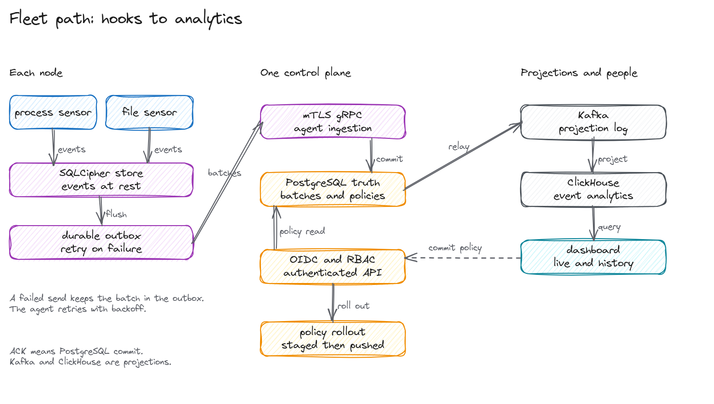
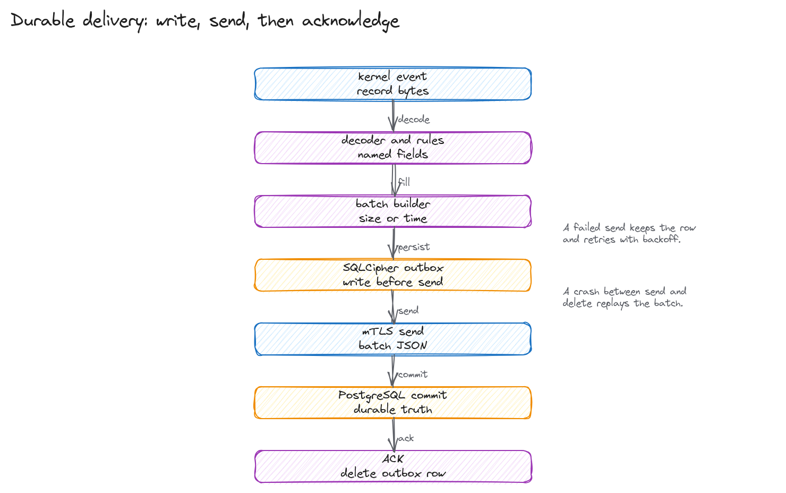
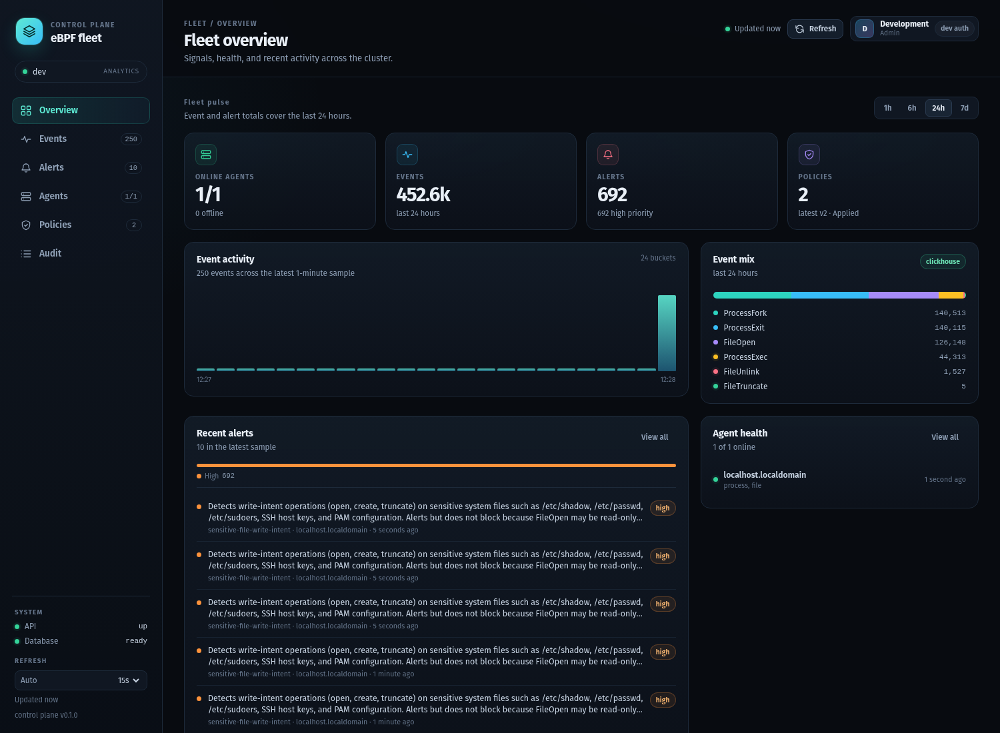
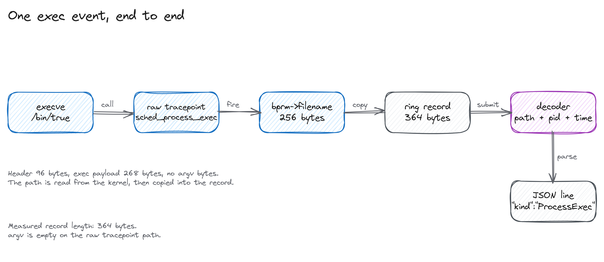
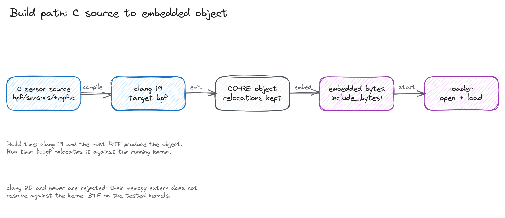

# eBPF fleet

Trace process and file activity on Linux nodes and carry the events to a
control plane. A node agent loads two eBPF sensors, decodes their ring
buffers, stores events in an encrypted local database, and sends batches to
a control plane over gRPC. The control plane commits each batch to
PostgreSQL before it acknowledges it. A dashboard reads the recent data,
and a relay projects committed batches to Kafka and ClickHouse.

The sensors are read-only. Rules raise alerts, and the project does not
block syscalls.



## Quick start

The build needs Linux 5.15 or newer with BTF at `/sys/kernel/btf/vmlinux`,
Rust 1.95, clang 19, bpftool, and permission to load BPF programs.

```bash
git clone https://github.com/meillaya/eBPF-runtime
cd eBPF-runtime
nix develop
cargo build --release
```

Run the original single-node tracer first:

```bash
sudo ./target/release/ebpf-runtime check
sudo ./target/release/ebpf-runtime run --pretty
```

`check` loads the sensors and prints what attached. `run` streams process
exec, file open, and rule alerts as JSON lines. Alerts go to stderr.

For the fleet stack, start PostgreSQL, Kafka, ClickHouse, the control
plane, and the relay with the development compose file, then open
`http://127.0.0.1:8080`:

```bash
podman compose up --build
```

The compose stack runs the control plane in its loopback development mode,
without OIDC or TLS. It is for evaluation, not for an untrusted network.
The agent container needs a rootful Podman or Docker daemon because it loads
BPF programs and mounts host kernel paths. The development file uses host
networking for the control plane and agent so the loopback-only development
bind still works; PostgreSQL and ClickHouse publish loopback ports for those
two containers. See [the rootful runbook](docs/runbooks/rootful-compose.md)
for the VM preflight, build, verification, and common SELinux and compose
provider failures.

A separate profile exercises the real identity path: Dex with OpenLDAP
groups, TLS, and per-node mTLS certificates. It is documented in
[the OIDC runbook](docs/runbooks/oidc-dex-ldap.md) and is not part of the
default development stack.

## How it fits together

Each agent owns a local pipeline:

1. The process sensor reports fork, exec, and exit from raw tracepoints.
2. The file sensor reports open, create, unlink, rename, and truncate from
   the LSM `file_open` hook and syscall kprobes.
3. The decoder turns the fixed event header and payload into named fields.
4. The process table adds the executable behind a file event when it knows
   the thread group.
5. The rule engine evaluates YAML conditions and produces alerts.
6. Redaction masks configured path prefixes and secrets before storage.
7. The agent writes the event to SQLCipher, builds a batch, and writes the
   batch payload to a durable outbox.
8. The delivery task sends batches to the control plane and deletes an
   outbox row only after an acknowledgement.

In TLS mode, the control plane validates the agent certificate, maps its
SPIFFE URI SAN to an agent row, and accepts each batch inside one PostgreSQL
transaction.
Batch ids and idempotency keys make a retry safe. The agent treats a
duplicate acknowledgement as success.



The relay reads batches that PostgreSQL has committed and that the relay
has not projected yet. It publishes one Kafka message per batch, inserts
the events and alerts into ClickHouse, and only then marks the batch as
relayed. A failure leaves the batch in the queue for the next pass.

## Control plane and policies

The control plane exposes an HTTP API and a gRPC ingest service. OIDC
bearer tokens are validated against a JWKS endpoint. Four roles come from
group names:

| Role | Groups | Access |
|---|---|---|
| Viewer | `ebpf-viewers` or `fleet-viewers` | Events, alerts, agents, policies, acknowledgements |
| Analyst | `ebpf-analysts` or `fleet-analysts` | Viewer access plus rule validation |
| Policy admin | `ebpf-policy-admins` or `fleet-policy-admins` | Stage, commit, and roll out policies |
| Admin | `ebpf-admins` or `fleet-admins` | Everything, including audit rows |

Policies are staged as YAML, validated by the same rule parser the agent
uses, and committed with a SHA-256 digest. A commit broadcasts the policy
on the agent control stream. Each agent checks the digest, writes the pack
to its local store, swaps the rule engine, and reports an acknowledgement
only after the swap. An agent that reconnects receives the current policy
as the first control command, so a rollback also reaches agents that were
disconnected when it happened.

A thresholded rollout is a separate step after commit. The control plane
snapshots the online agent count, requires a previous committed version to
roll back to, broadcasts the target, and counts applied acknowledgements
after the rollout started. It promotes when the ratio is met and broadcasts
the previous version on timeout or on any rejection. There is at most one
pending rollout per cluster, and a new commit is refused while one is
pending. The API is `POST /api/v1/policies/{version}/rollout`;
`ebpfctl rollout` and `ebpfctl rollout-status` are the command-line path.
The dashboard shows the latest rollout status per policy version.

## Dashboard

The control plane serves a single-page dashboard at its HTTP port. It is a
snapshot client: it polls the API on a configurable interval instead of
pretending to have a push stream. The agent-local WebSocket remains an agent
endpoint, not a control-plane feed.



- **Overview** shows fleet KPIs from ClickHouse analytics, a recent event
  activity chart, event-mix and alert-severity breakdowns, recent alerts,
  agent health, recent events, control-plane/database health, and the latest
  policy/rollout state. The analytics window is selectable.
- **Events** has full-text filtering, kind filtering, JSON/CSV export, and a
  detail drawer with the raw event and any related alerts.
- **Alerts** filters by severity and search, and opens a detail drawer with
  the rule, node, explanation, and raw JSON.
- **Agents** shows online/offline state, last heartbeat, SPIFFE identity,
  generation, and reported sensors, with a detail drawer.
- **Policies** is a working surface: hydrate the canonical default pack or
  load a YAML file, validate with the agent parser, stage, commit, start a
  thresholded rollout, inspect acknowledgements, and read the stored YAML.
- **Audit** is visible only to admins and filters success/failure rows.

The controls follow the token role: viewers get read-only surfaces, analysts
can validate YAML, policy admins can stage/commit/roll out, and admins also
get audit. The dashboard reads `/api/v1/meta` for the cluster name, build
version, and whether ClickHouse analytics is configured. The topbar exposes a manual refresh, the sidebar exposes the
auto-refresh interval, and the dashboard sign-in flow uses the same Dex
issuer as the control plane.

## Deployment

The image contains the agent, control plane, relay, CLI, dashboard, benchmark
gate, and the single-node tracer. The compose file is the shortest path to a working
development stack.

For a host install, the systemd units run the agent as a privileged
service with only the BPF capabilities it needs. The control plane and
relay run as unprivileged users. Place `storage.key` and the mTLS
certificate under `/etc/ebpf-agent` on each node. Use one certificate per
node; never share a client certificate across agents. The control plane
maps the certificate's SPIFFE URI SAN to one agent row.

The agent polls its certificate, key, and CA metadata. When the files are
replaced it logs `TLS material changed; restarting agent` and exits; the
systemd unit uses `Restart=always` and Kubernetes restarts the container.
This is the first-version rotation behavior. It does not swap a live TLS
connection. SPIRE is deliberately not deployed here; see
[the identity decision](docs/decisions/0001-per-node-identity.md) for the
criteria and the SPIRE path.

The Helm chart deploys one control plane, one relay, and an agent
DaemonSet. The agent mounts `/sys/kernel/btf`, `/sys/kernel/debug`,
`/sys/fs/bpf`, `/proc`, the encrypted state directory, and a per-node
credential directory. On each node, provision:

- `/etc/ebpf-agent/storage.key`, 32 random bytes.
- `/etc/ebpf-agent/tls/ca.crt`, `tls.crt`, and `tls.key`, with a SPIFFE URI
  SAN that identifies that node's agent.

The chart runs the agent with `privileged: true` because the LSM attach
path needs `CAP_SYS_ADMIN` in addition to `CAP_BPF` and `CAP_PERFMON`.
Set `agent.transport.enabled=false` only for a local-only rollout.

## Commands

| Command | Purpose |
|---|---|
| `ebpf-runtime check` | Load sensors and print the attach matrix. |
| `ebpf-runtime run` | Stream single-node events and alerts. |
| `ebpf-runtime rules check DIR` | Parse a rule directory. |
| `ebpf-agent init` | Create the storage key and encrypted database. |
| `ebpf-agent run` | Run the node agent and local API. |
| `ebpf-agent keygen` | Write a new 32-byte storage key. |
| `ebpf-agent status` | Print local outbox and event status. |
| `ebpf-control-plane serve` | Run gRPC ingest, HTTP API, and dashboard. |
| `ebpf-control-plane migrate` | Apply PostgreSQL migrations. |
| `ebpf-relay` | Project committed batches to Kafka and ClickHouse. |
| `ebpf-bench` | Run the ingest gate. |
| `ebpfctl` | Query agents, events, policies, rollouts, and audit rows. |
| `ebpfctl rollout VERSION` | Start a thresholded rollout (`--min-ratio`, `--timeout-secs`, `--force`). |
| `ebpfctl rollout-status VERSION` | Show the latest rollout. |
| `ebpfctl rollouts` | List recent rollouts. |

The agent serves a loopback API on `127.0.0.1:9464`:

| Endpoint | Contents |
|---|---|
| `/api/v1/health` | Liveness. |
| `/api/v1/readyz` | Readiness and outbox depth. |
| `/api/v1/events` | Recent events, optionally filtered by kind. |
| `/api/v1/alerts` | Recent alerts. |
| `/api/v1/outbox` | Unacknowledged batch count. |
| `/api/v1/status` | Agent id, cluster, node, uptime, and sensor coverage. |
| `/api/v1/metrics` | Prometheus text format. |
| `/api/v1/events/stream` | WebSocket event feed. |

The control plane serves `/healthz`, `/readyz`, `/metrics`, and the
authenticated `/api/v1` routes. Its HTTP port also serves the dashboard.

## Limits

- The sensors do not enforce policy. A deny rule is rejected at load time.
- Only the process and file sensors are produced. The ABI defines network,
  DNS, syscall, identity, and LSM records, but no BPF program emits them.
- One control plane serves one cluster in this version.
- Prometheus is always available. OTLP/HTTP metrics export is optional and
  off by default; it posts the same numeric samples as the local scrape
  endpoint.
- The relay writes to Kafka and ClickHouse directly. It does not run a
  Kafka consumer, so ClickHouse ingestion does not depend on consumer lag.
- Certificate issuance is outside the project. The control plane parses a
  SPIFFE URI SAN, but it does not run a SPIRE server or agent.
- SQLCipher key rotation is not automated.
- Rollouts assume one policy name per cluster; policy versions are treated
  as cluster-unique. The rollout row keeps the policy id to avoid updating
  the wrong version, but acknowledgements are keyed by version.
- The rollout denominator is snapshotted when the rollout starts. An agent
  that goes offline after that still counts, so the timeout is the safety
  path; an agent that was offline at the start is excluded unless `--force`
  is used.
- Certificate rotation restarts the agent. A live TLS connection swap is
  future work.
- `ebpfctl login` stores a pasted token. It does not run an OAuth device
  flow.
- Container and Kubernetes enrichment are not included.
- The dashboard has no user administration page. It reads roles from the
  token's group claim and relies on the API for enforcement.

## Build and test

```bash
nix develop
cargo test --workspace
cargo clippy --workspace --all-targets -- -D warnings
cargo run -p bpf-build -- build
sudo -E scripts/run-privileged-tests.sh
```

The workspace tests include live paths when `DATABASE_URL` and
`CLICKHOUSE_URL` are set. The gRPC test starts a development control plane,
registers an agent, publishes a batch twice, and checks that the second
reply is a duplicate. The agent test drains an outbox, commits a policy,
and checks that the agent persists it. The rollout tests cover promotion,
timeout rollback, offline-agent exclusion, immediate rollback on a
rejected acknowledgement, missing previous versions, and a second pending
rollout.

The live OIDC harness generates test certificates under `target/oidc`,
starts Dex, OpenLDAP, PostgreSQL, ClickHouse, the control plane, relay, and
a per-node mTLS agent, then runs the API assertions and the Playwright
login flow:

```bash
scripts/gen-test-certs.sh
podman compose -f deploy/compose/oidc/compose.yaml up -d --build
scripts/oidc/api-tests.sh
cd web && EBPF_WEB_URL=http://127.0.0.1:8081 bunx playwright test
```

The test CA is trusted only by the control plane's JWKS client and by the
browser/test process. It is never installed system-wide.

The benchmark gate sends synthetic batches to a control plane:

```bash
./target/release/ebpf-bench \
  --insecure \
  --endpoint http://127.0.0.1:9443 \
  --cluster dev \
  --events 20000 \
  --batch-size 500 \
  --max-p99-ms 250 \
  --min-events-per-sec 5000
```

On this host, with a local PostgreSQL 16.15 and the development control
plane, the release benchmark sent 20,000 events in 40 batches at 23,091
events per second. The p50 batch latency was 21.39 ms and p99 was 23.27 ms.
These numbers describe this host and this local setup, not a production
cluster.

The sensors have been tested on Linux 7.2.7 on x86_64 with clang 19.1.7.
The control plane, relay, and projections were exercised with PostgreSQL
16.15, Kafka 4.3.1, and ClickHouse 26.8.7.



The exec path reads `bprm->filename`, copies up to 256 bytes, and submits a
364-byte record. The decoder writes the path, pid, and timestamp as one
event. The raw tracepoint does not carry argv.



The build compiles the C sensors with clang 19 and embeds the CO-RE objects
in the binary. The runtime relocates them against the running kernel with
libbpf. clang 20 and newer produce a `memcpy` extern that libbpf cannot
resolve on the kernels tested here, so the build rejects them.
