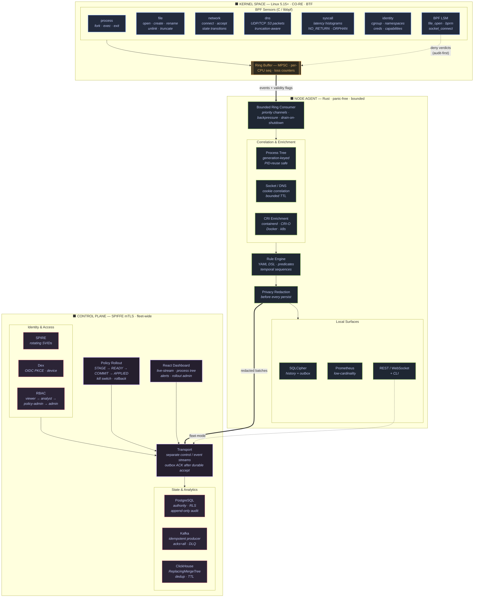

# kernel-v1 — eBPF Runtime Security & Observability

A production-style Linux eBPF runtime security and observability platform.
C/libbpf CO-RE sensors, a Rust node agent, a typed YAML rule engine,
audit-only-by-default BPF LSM enforcement, a SPIFFE-authenticated fleet
control plane, and a React/TypeScript dashboard.

## Architecture



**Data flow:** sensors emit versioned events with validity/degradation flags into
a shared ring buffer → the agent consumes with bounded backpressure, reconstructs
process trees and correlates sockets/DNS, evaluates rules, redacts, then persists
locally (SQLCipher) and ships to the control plane over SPIFFE mTLS → PostgreSQL
holds authoritative state, Kafka carries event batches, ClickHouse serves
analytics, and the dashboard streams live + historical views.

**Enforcement is audit-first:** the LSM sensor records `OWN_LSM_DENY` only when
*its own* program returns an errno, preserves any prior LSM's nonzero return,
fails open on unknown context, and honors an immediate kill switch. Deny links
are never pinned.

## Quick Start

```bash
# Enter the dev environment (Nix-based, pins all tooling)
devenv shell

# Build everything
cargo build --workspace

# Run tests (1398 tests)
cargo test --workspace

# Start dev infrastructure (PostgreSQL, Kafka, ClickHouse, SPIRE, Dex)
devenv tasks run infra:up

# Run the dashboard in dev mode (loopback = admin, no OIDC needed)
cd web && bun install && bun run dev

# Run BPF sensors (requires privileged container or CAP_BPF)
sg docker -c "docker run --rm --privileged \
  -v $(pwd):/workspace -v /sys/fs/bpf:/sys/fs/bpf \
  -v /sys/kernel/debug:/sys/kernel/debug \
  -w /workspace archlinux:latest \
  bash -c 'pacman -Sy --noconfirm clang llvm libbpf bpftool && \
    clang -target bpf -D__TARGET_ARCH_x86 -I bpf/include -O2 \
    -c bpf/sensors/process.bpf.c -o /tmp/process.bpf.o && \
    bpftool prog load /tmp/process.bpf.o /sys/fs/bpf/process'"
```

## Directory Layout

| Path | Purpose |
|------|---------|
| `bpf/` | C/libbpf CO-RE sensors (7 programs: process, file, network, dns, syscall, identity, lsm) |
| `crates/` | 22 Rust workspace crates (agent, rules, enforcement, protocol, auth, transport, etc.) |
| `web/` | React 18 + TypeScript + Vite dashboard with Playwright e2e suite |
| `proto/` | Versioned Protobuf schemas (events/v1, control/v1) |
| `deploy/` | Systemd unit, OCI Dockerfiles, Helm chart, Compose stacks |
| `rules/` | Default rule packs (sensitive-files, reverse-shell, container-escape) |
| `bench/` | Benchmark harness, comparators, workloads, versioned JSON schemas |
| `tests/` | Integration fixtures, privileged BPF tests, security/durability suites |
| `scripts/` | Preflight, evidence validation, LOC/SPDX linting, VM launcher |
| `schemas/` | JSON Schemas (preflight, evidence, rule-v1) |

## Crates

| Crate | Purpose |
|-------|---------|
| `event-abi` | Versioned C→Rust event ABI with safe parser, validity flags |
| `bpf-build` | Deterministic CO-RE build pipeline (clang → skeleton) |
| `bpf-loader` | Load/attach manager with degrade matrix, coverage reporting |
| `sensor-tests` | Fixture-based sensor verification (privileged + synthetic) |
| `agent-core` | Bounded ring consumer, process tree, socket/DNS correlation |
| `enrichment` | CRI/containerd/CRI-O/Docker/Kubernetes workload identity |
| `privacy` | Redaction engine (AWS/Stripe/Bearer/password masking) |
| `storage-local` | SQLCipher-v4 local history + durable outbox |
| `observability` | Prometheus metrics, structured logging, health endpoints |
| `agent` | Standalone node service (REST/WebSocket API) |
| `cli` | Fleet-aware CLI with stable exit codes, device-flow auth |
| `rules` | YAML rule DSL: predicates, sequences, lists, exceptions |
| `enforcement` | Staged policy maps, kill switch, loader-death fail-open |
| `protocol` | Typed fleet state machines, message bounds, deadlines |
| `identity-spiffe` | SPIFFE Workload API client, rotating SVIDs, mTLS |
| `auth` | OIDC PKCE + device flow, RBAC (viewer/analyst/policy-admin/admin) |
| `control-db` | PostgreSQL migrations, RLS, append-only audit |
| `transport` | Separate gRPC control/event streams, outbox ACK |
| `event-bus-kafka` | Idempotent Kafka publisher (acks=all, at-least-once) |
| `analytics-clickhouse` | ReplacingMergeTree dedup, DLQ routing, exact queries |
| `control-plane` | Authenticated query API, live-stream fanout, policy rollout |
| `policy-rollout` | Two-phase STAGE→READY→COMMIT→APPLIED fleet coordination |

## BPF Sensors

| Sensor | Hooks | Semantic honesty |
|--------|-------|-----------------|
| `process.bpf.c` | sched fork/exec/exit raw tracepoints | TASK_FORK, EXEC_RESULT, TASK_EXIT, NO_RETURN |
| `file.bpf.c` | LSM file_open/file_permission + syscall fallback | Distinguishes OWN_LSM_DENY vs PRIOR_LSM vs SYSCALL_FALLBACK |
| `network.bpf.c` | cgroup connect4/6, syscall accept, inet state | ATTEMPT ≠ ESTABLISHED; errno on failure |
| `dns.bpf.c` | cgroup_skb ingress/egress port 53 | "packet observed" not "lookup performed"; truncation flag |
| `syscall.bpf.c` | raw sys_enter/sys_exit | Wall time (not CPU); NO_RETURN, ORPHAN_ENTER/EXIT counters |
| `identity.bpf.c` | cgroup/ns/credential helpers | Per-field validity; never PID alone as identity |
| `lsm.bpf.c` | file_open, bprm_check_security, socket_connect | Audit-first; own-denial only; prior-ret preservation; kill switch |

## Rule Engine

Rules are versioned YAML with typed fields, bounded predicates, temporal
sequence windows, and safe exceptions:

```yaml
# rules/default/sensitive-files.yaml (excerpt)
rules:
  - id: sensitive-file-mutation
    severity: critical
    source: file
    condition:
      and:
        - field: file.kind
          operator: in
          value: ["FileRename", "FileUnlink"]
        - field: file.path
          operator: in
          value: ["/etc/shadow", "/etc/sudoers", "/etc/passwd"]
    action: deny  # kernel-observable fields only
    exceptions:
      - field: process.exec_path
        operator: in
        value: ["/usr/bin/apt", "/usr/bin/dpkg", "/usr/bin/pacman"]
```

Three default packs ship: **sensitive-files**, **reverse-shell** (temporal
sequence: exec→connect→dup2), and **container-escape** (namespace/mount/socket
indicators).

## Deployment

### Systemd (bare metal)
```bash
sudo scripts/install-systemd.sh
# Runs as dedicated kernel-v1 user with ambient CAP_BPF+CAP_PERFMON+CAP_SYS_ADMIN
```

### Docker Compose (dev)
```bash
docker compose -f deploy/compose/dev-infra.yml up -d
# PostgreSQL :5432 | Kafka :9092 | ClickHouse :8123 | SPIRE :8081 | Dex :5556
```

### Kubernetes (Helm)
```bash
helm install kernel-v1 deploy/helm/kernel-v1 \
  --set external.postgresql.host=pg.internal \
  --set external.kafka.brokers=kafka:9092
```

### OCI Images
```bash
docker buildx bake -f deploy/oci/docker-bake.hcl  # amd64 + arm64
```

## Verification

| Suite | Tests | What it proves |
|-------|-------|---------------|
| `cargo test --workspace` | 1398 | All Rust unit/integration tests |
| `bun run test:e2e` (web/) | 73 | Playwright: nav, a11y, responsive, live-stream, process tree |
| `tests/security/run_all.sh` | 55 | OIDC/RBAC/PostgreSQL/policy adversarial tests (vs live Dex+PG) |
| `tests/durability/run-all.sh` | 55 | Kafka/ClickHouse/PostgreSQL/outbox durability (vs live infra) |
| `bench/compat-matrix.sh` | 11 features | BTF, LSM, cgroup v2, TCX, ringbuf on current kernel |
| `bench/benchmark.sh` | 4 workloads × 6 comparators | Sub-5% p99/throughput gate (statistical CI) |
| `tests/privileged/task53/` | live BPF | Sensor ordering, saturation loss, supported-load envelope |
| `bench/enforcement-live.sh` | live LSM | Deny/audit/kill-switch on kernel 7.1.3 |

## Toolchain

- **Rust** 1.95.0 (pinned via `rust-toolchain.toml`)
- **Clang/LLVM** for BPF CO-RE compilation
- **Bun** for web package management
- **Nix/devenv** for reproducible dev environment
- **Docker/Podman** for infrastructure and privileged BPF testing

## Licensing

Dual-licensed **Apache-2.0 OR MIT** (user-space Rust, dashboard, schemas).
BPF LSM programs use **GPL-2.0-only** (kernel requirement for
`BPF_PROG_TYPE_LSM`). Tracing programs use dual MIT/Apache-2.0.

## Known Limitations

- 4 BPF sensors (network, dns, syscall, lsm) need CO-RE relocation fixes for
  kernels other than 7.1.3 (process, file, identity load on all tested kernels)
- Multi-kernel compatibility matrix (5.15/6.1/6.6/arm64) requires VMs
- Benchmark comparative gate requires strace/auditd/Falco installed on the host
- SPIRE agent attestation tested with join_token only (X.509/mTLS in production)
